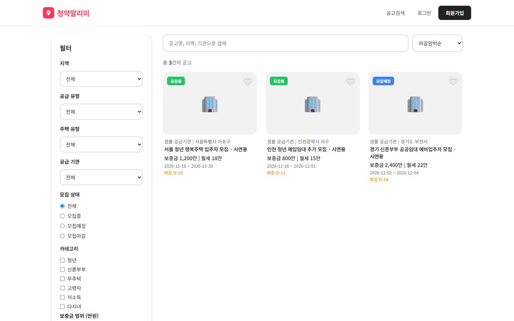
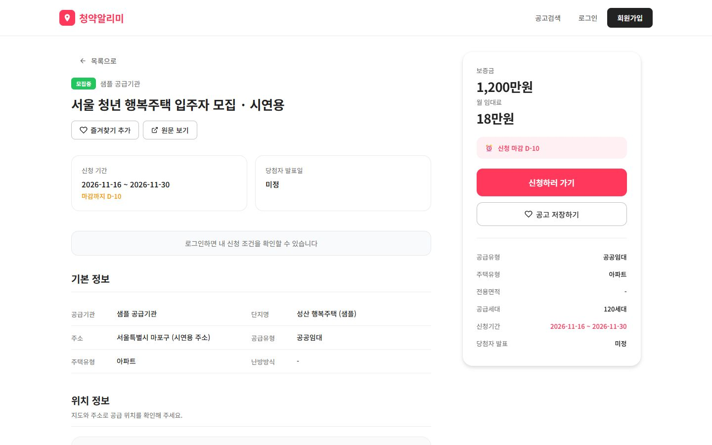

# 청약 따잇 · Subscription-TTAIT

공공주택 청약 공고를 수집하고, 내 조건에 맞는 공고와 신청 일정을 확인하는 웹 서비스입니다.

LH 공고와 PDF에 흩어진 모집 정보·공급 유형·자격 조건을 구조화해 검색과 추천에 활용합니다. 사용자는 관심 공고를 저장하고 조건 체크리스트, 주변 시세, 신청 일정을 함께 살펴볼 수 있습니다.

## 실제 실행 화면

로컬 프론트엔드·백엔드와 임시 MySQL을 연결해 캡처했습니다. 화면의 계정·프로젝트·공고는 포트폴리오 시연을 위한 합성 데이터입니다.

### 공고 목록



지역·유형별 필터와 합성 공고 3건

### 공고 상세



모집 기간과 비용 정보 확인

## 주요 기능

| 기능 | 내용 |
| --- | --- |
| 공고 검색과 상세 조회 | 지역, 공급·주택 유형, 모집 상태, 보증금·월세, 키워드로 공고를 조회합니다. |
| 맞춤 추천과 상세 리포트 | 사용자 프로필과 공고의 조건을 비교해 추천 결과와 항목별 근거를 제공합니다. |
| 조건 충족도 체크리스트 | 나이·혼인·자녀·무주택·예산 등 항목별로 충족 여부와 추가 확인이 필요한 내용을 표시합니다. |
| 주변 시세 비교 | 공고의 공급 단위와 주변 주택 거래 데이터를 비교하는 API를 제공합니다. |
| 즐겨찾기와 신청 일정 | 저장한 공고를 모집 일정과 캘린더 이벤트로 조회하고 이메일 알림과 연결합니다. |
| 관리자 공고 수집·검수 | LH 후보 공고를 수집하고, 선택한 후보의 PDF를 AI로 파싱한 뒤 검수합니다. |

조건 체크리스트는 저장된 프로필과 파싱된 공고를 바탕으로 확인할 항목을 안내합니다. 소득·자산처럼 추가 자료가 필요한 조건은 확인 필요 상태로 표시합니다.

## 사용자 흐름

```text
공고 탐색 → 공고 상세 → 내 조건 확인·추천 근거 조회
                       → 주변 시세 비교
                       → 즐겨찾기 → 신청 일정·알림 확인
```

관리자는 LH 후보 수집 → 후보 선택 → PDF 파싱 → 검수 순서로 공고를 관리합니다.

## 구현에서 다룬 문제

### 변경 없는 공고의 AI 재파싱 방지

LH 목록·상세 정보와 PDF URL을 fingerprint로 관리합니다. 기존에 성공적으로 처리한 공고의 정보가 같으면 Gemini 호출을 생략하고 파싱 결과를 유지합니다. 변경된 공고, 실패 후 재시도, 관리자 강제 재파싱은 별도로 처리합니다.

후보 수집과 정식 import를 나눠, 관리자가 선택한 후보만 PDF 파싱 단계로 넘길 수 있게 했습니다. [공고 수집·중복 방지 명세](subscrition/docs/API수집/현행_LH공고수집_중복방지_관리자선택흐름_기능명세.md)

### 공고 목록의 DB 필터링과 페이지네이션

공고 전체를 메모리에 읽어 필터링하던 목록 조회를 DB에서 검색·정렬·페이지네이션하는 구조로 개선했습니다. 지역과 가격 등의 조건에 맞는 페이지를 조회하도록 구성했습니다. [목록 조회 개선 기록](subscrition/docs/주변시세%20비교/개발/현행_공고목록_DBPagination_개발완료요약.md)

### 사용자 조건 판정과 개인화 응답

조건 판정 로직을 evaluator로 분리하고 항목별 상태, 요약, 확인 근거를 DTO에 담았습니다. API는 로그인한 사용자의 프로필을 사용하고, 개인화 응답에 `Cache-Control: private, no-store`를 적용합니다. [조건 체크리스트 구현 기록](subscrition/docs/조건_충족도&신청_가능성/현행_조건충족도_신청가능성_백엔드_개발완료요약_2026-06-09.md)

## 기술 스택

| 영역 | 기술 |
| --- | --- |
| Frontend | React 18, React Router 6, Vite 6 |
| Backend | Java 17, Spring Boot 3.3.2, Spring Data JPA, Spring Security |
| 인증 | JWT |
| Database | MySQL |
| PDF·AI | Apache PDFBox, Gemini API |
| 외부 연동 | LH 공고 API, NAVER Maps API, 실거래가 API, SMTP |
| API 문서·테스트 | Springdoc OpenAPI, JUnit 5, Spring Boot Test, Spring Security Test |

## 저장소 구조

| 경로 | 용도 |
| --- | --- |
| [`app/`](app/) | React 기반 사용자·관리자 웹 앱 |
| [`subscrition/`](subscrition/) | Spring Boot 백엔드와 기능별 구현·검증 문서 |
| [`docs/`](docs/) | 프론트엔드 명세, 기획, 팀 인수인계 자료 |
| [`pdf-ai-poc/`](pdf-ai-poc/) | PDF·AI 파싱 실험 |
| [`ttait_Front/`](ttait_Front/) | 디자인 시스템과 화면 시안 |
| [`before/`](before/) | 이전 버전 코드·시안 |

백엔드 폴더명은 저장소의 `subscrition` 표기를 사용합니다.

## 로컬 실행

JDK 17, Node.js와 npm, MySQL이 필요합니다.

### Backend

`subscrition/src/main/resources/application.properties`의 환경변수에 맞춰 DB와 외부 API 설정을 준비합니다. 백엔드는 실행 디렉터리의 `.env`를 properties 형식으로 읽습니다.

| 환경변수 | 용도 |
| --- | --- |
| `DB_URL`, `DB_USERNAME`, `DB_PASSWORD` | MySQL 연결 |
| `JWT_SECRET` | JWT 서명 |
| `LH_SERVICE_KEY`, `GEMINI_API_KEY` | 공고 수집과 PDF AI 파싱 |
| `NAVER_MAPS_CLIENT_ID`, `NAVER_MAPS_CLIENT_SECRET` | 지도 연동 |
| `RTMS_SERVICE_KEY` | 주변 실거래가 조회 |
| `MAIL_HOST`, `MAIL_PORT`, `MAIL_USERNAME`, `MAIL_PASSWORD`, `NOTIFICATION_FROM_EMAIL` | 이메일 알림 |

```bash
cd subscrition
bash ./gradlew bootRun
```

Windows PowerShell에서는 `.\gradlew.bat bootRun`을 사용합니다.

### Frontend

```bash
cd app
npm install
npm run dev
```

개발 서버는 `http://localhost:5173`에서 열리며, `/api` 요청을 `http://localhost:8080`으로 전달합니다.

## 검증 자료

아래는 저장소에 남아 있는 검증 기록입니다.

- [조건 충족도 API E2E 기록](subscrition/docs/조건_충족도&신청_가능성/현행_조건충족도_신청가능성_E2E_테스트기록_2026-06-09.md)
- [즐겨찾기 일정 MySQL E2E 기록](subscrition/docs/즐겨찾기%20일정/현행_즐겨찾기_일정_MySQL_E2E_테스트기록_2026-06-12.md)
- [LH 공고 수집 수동 테스트 가이드](subscrition/docs/API수집/중간발표_이후/현행_LH공고수집_단위데이터구조개편_수동테스트가이드.md)

백엔드 테스트와 프론트엔드 빌드는 각각 다음 명령으로 실행합니다. DB 및 외부 서비스 연동 검증에는 해당 환경 설정이 필요합니다.

```bash
cd subscrition
bash ./gradlew test
```

```bash
cd app
npm run build
```
